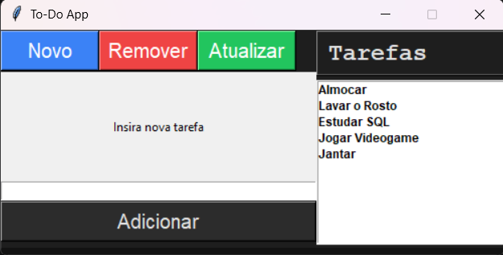

# To-Do App

Aplicação de gerenciamento de tarefas desenvolvida em Python, com integração ao banco de dados SQLite para armazenamento persistente das informações. O projeto permite organizar atividades por meio de uma interface de gerenciamento simples e funcional.

## Funcionalidades

- Adicionar tarefas: permite cadastrar novas tarefas.
- Editar tarefas: permite modificar tarefas existentes.
- Excluir tarefas: permite remover tarefas cadastradas.
- Concluir tarefas: permite marcar tarefas como concluídas.
- Persistência de dados: utiliza SQLite para armazenar as informações, mantendo os registros mesmo após o encerramento da aplicação.

## Tecnologias utilizadas

Python: linguagem utilizada no desenvolvimento da aplicação.

SQLite: banco de dados relacional utilizado para armazenamento persistente das tarefas.

Estrutura do projeto

To-Do-App/
│
├── main.py
├── db.py
└── README.md

  ">

## Como executar

1. Certifique-se de ter o Python instalado.

2. Clone o repositório:

git clone https://github.com/spiwskyn0-prog/To-Do-App.git

3. Acesse a pasta do projeto:

cd To-Do-App

4. Execute a aplicação:

python main.py

## Objetivo do projeto

Projeto desenvolvido com o objetivo de praticar conceitos fundamentais de programação em Python, manipulação de dados, organização de funções e integração com bancos de dados relacionais por meio do SQLite, além de desenvolver uma ferramenta para organização de tarefas pessoais.

## Autor

Miguel Galego

Estudante de Engenharia de Software.
